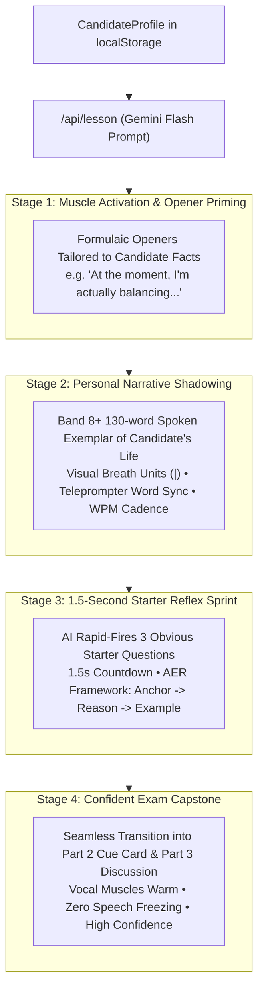

# AGENTIC SPECIFICATION & PRODUCT REQUIREMENTS DOCUMENT (PRD)
## English Phonetics & Vocal Laboratory — Personalized Speaking Reflex Studio

> **Version:** 2.0.0  
> **Target Audience for this Document:** Autonomous AI Coding Agents, Software Architects, and Engineers.  
> **Core Mission:** Transform the platform from random science trivia into a **Personalized Speech Motor Reflex Studio** inspired by Tarteel AI's hands-free voice tracking, Keith O'Hare's Formulaic Chunking, and Chris Pell's Direct Answer Framework.

---

## 1. Executive Summary & Problem Diagnosis

### The Problem in Speaking Tests (IELTS, TOEFL, Job Interviews)
- **The Cognitive Bottleneck:** Candidates don't freeze because they lack grammar; they freeze because their **vocal muscles and speech retrieval are cold**.
- **The First 90-Second Crisis:** The initial 2 to 3 minutes of an exam consist of predictable, foundational questions (*"Where are you from?", "Do you work or study?", "What is your neighborhood like?"*). When nervous candidates stumble or give dead-end answers here, anxiety cascades, ruining their confidence for the rest of the test.
- **Flaw of Previous Versions:** The previous iteration generated random academic topics (*"Deep Ocean Bathymetry"*, *"Mycelial Networks"*). While linguistically rich, they were disconnected from the physical muscle memory needed for real-life speaking success.

### The Solution: "Master Your Own Story" via Local Memory
Instead of practicing fictional text, the system captures the candidate's **actual personal background once into Local Memory (`localStorage`)**, then conditions their vocal tract to deliver their own real-life narrative with zero hesitation, natural rhythm, and Band 8+ conversational cadence.

---

## 2. Pedagogical Methodology & Research Foundations

Agents implementing this curriculum must ground all prompt designs and UI patterns in these three evidence-based frameworks:

```
┌────────────────────────────────────────────────────────────────────────┐
│                   THE 3 PEDAGOGICAL FOUNDATIONS                        │
├────────────────────────────────┬───────────────────────────────────────┤
│ 1. FORMULAIC SEQUENCES (CHUNKS)│ Keith O'Hare (Keith Speaking Academy) │
│    • Speech is retrieved in    │ • Focus on 2-3 word native blocks:    │
│      pre-assembled blocks.     │   "I tend to...", "To be candid..."   │
├────────────────────────────────┼───────────────────────────────────────┤
│ 2. DIRECT ANSWER FRAMEWORK     │ Chris Pell (IELTS Advantage)          │
│    • The 3-Sentence Micro-Unit │ • 1. Direct Answer (Anchor)           │
│    • Eliminates the "Shotgun"  │ • 2. Reason / Context                 │
│      or "Dead-End" traps.      │ • 3. Concrete Example / Nuance        │
├────────────────────────────────┼───────────────────────────────────────┤
│ 3. HANDS-FREE CADENCE SHADOWING│ Tarteel AI Voice-Tracking Paradigm    │
│    • Visual Teleprompter       │ • Candidate shadows spoken narratives │
│    • Breath Pause Units (|)    │ • Rhythmic WPM pace conditioning      │
└────────────────────────────────┴───────────────────────────────────────┘
```

---

## 3. Scope Boundaries: In-Bound vs. Out-of-Bound

To preserve simplicity, sub-second latency, and zero hosting costs, agents must strictly respect these scope boundaries:

### In-Bound (Core Deliverables)
- [x] **Client-Side Local Profile Memory:** Persistent storage of candidate facts via `localStorage` (name, occupation/major, hometown, current residence, favorite habit, goal).
- [x] **Personalized Curriculum Generation:** Serverless generation via Gemini Flash where all model answers and drills directly feature the candidate's actual life.
- [x] **4-Stage Reflex Protocol:**
  1. *Personalized Chunk Priming* (Opening phrase muscle drills).
  2. *Exemplar Narrative Shadowing* (Tarteel-style continuous teleprompter with breath pause units `|` and WPM telemetry).
  3. *The 1.5-Second Reflex Sprint* (Rapid-fire starter questions with visual countdown timer).
  4. *Topic Expansion & IELTS Simulation* (Transition into authentic Part 2 & Part 3 exam questions).
- [x] **Audio DSP & Visual Telemetry:** Dual-trace HTML5 Canvas oscilloscope (candidate dBFS RMS waveform + examiner FFT frequency formants), RTT, TTFB, and audio underrun packet monitoring.
- [x] **AER Visual Guide Chips:** Real-time on-screen cues for `[ DIRECT ANSWER ]` → `[ REASON ]` → `[ DETAIL ]`.

### Out-of-Bound (Explicit Non-Goals)
- [ ] **No Cloud Databases or User Accounts:** Do not introduce Supabase, Firebase, PostgreSQL, or Clerk. All profile data stays local for maximum candidate privacy and zero infrastructure overhead.
- [ ] **No Full Multi-Module Exam Engine:** Do not build writing, listening, or reading modules. This is strictly a *Vocal Articulation & Speaking Muscle Gym*.
- [ ] **No Heavy 3D Avatars:** Do not introduce Three.js or heavy 3D head models; low-latency Canvas oscilloscopes are lighter, more scientific, and distraction-free.

---

## 4. Local Memory Schema & Data Model

Stored in the browser under key `vocal_lab_candidate_profile`:

```typescript
export interface CandidateProfile {
  // Identity
  fullName: string;
  preferredName: string;
  
  // Core Speaking Pillar 1: Work & Study
  status: "working" | "studying" | "both" | "transitioning";
  occupationOrMajor: string;
  fieldDetails: string; // e.g. "building cloud distributed systems" or "corporate finance"
  workplaceOrInstitution: string;

  // Core Speaking Pillar 2: Hometown & Roots
  hometownName: string;
  hometownVibe: string; // e.g. "bustling coastal seaport" or "tranquil mountain valley"
  currentResidence: string; // e.g. "apartment in the central district"
  livingSetup: "apartment" | "house" | "shared_flat" | "dormitory";
  favoriteRoom: string;

  // Core Speaking Pillar 3: Daily Routine & Habits
  morningRoutine: string; // e.g. "filter coffee and 30 minutes of strength training"
  unwindingHabit: string; // e.g. "cooking pasta or reading speculative fiction"

  // Target Metrics
  targetBand: "6.5" | "7.5" | "8.5";
  examPurpose: string; // e.g. "Canadian Express Entry" or "Cambridge Master's admission"

  // Telemetry metadata
  lastUpdated: number;
}
```

---

## 5. The 4-Stage Laboratory Curriculum Specification



### Detailed Stage Breakdown

#### Protocol 01: Conversational Opener Priming (`motor_warmup`)
- **Objective:** Warm up mouth, tongue, and speech retrieval on high-frequency opening blocks.
- **Mechanism:** Drills 4 formulaic sequences directly containing the candidate's career and city facts.
- **Example Drills:**
  - *"Well, to be perfectly candid, I've spent the past few years working in..."*
  - *"I was born and raised in [Hometown], but recently I've relocated to [City]..."*
  - *"Whenever I get some breathing room after work, I make a point of..."*

#### Linguistic Enhancement Directives for Prompts:
1. **Sentence Structure Upgrades:**
   - Inject **Cleft Sentences** (*"What I find most appealing about [hometown] is..."*).
   - Inject **Concessive Contrast Clauses** (*"While working as a [job] can be demanding, it offers..."*).
   - Inject **Conditionals** (*"If I had the chance to relocate, I'd almost certainly opt for..."*).
2. **Grammar Precision Directives:**
   - Require clean tense transitions (Past Simple for origin $\rightarrow$ Present Perfect for ongoing life $\rightarrow$ Modals for future perspective).
   - Use modals of deduction & hedging (*tend to, might well be, naturally*).
3. **Vocabulary & Phrasal Verb Upgrades:**
   - Avoid generic adjectives (*good, nice, bad*). Use collocation triads (*intellectually stimulating, vibrant community, steep learning curve*).
   - Integrate native phrasal verbs (*unwind, opt for, grapple with, phase out*).
   - Enforce structural paraphrasing instead of isolated synonym replacements.

#### Protocol 02: Exemplar Narrative Shadowing (`long_reading`)
- **Objective:** Ingest natural British/cadence rhythm and stress-timing into physical muscle memory.
- **Mechanism:** The AI constructs a 120–150 word authentic spoken monologue about the candidate's actual life, formatted with natural breath pauses (`|`).
- **Tarteel Teleprompter Features:**
  - Words advance and highlight in real time as the candidate speaks.
  - Real-time cadence calculation: $\text{WPM} = \frac{\text{Words Spoken}}{\text{Time in Minutes}}$.
  - Optional audio model: Candidate can listen to the AI demonstrate the passage at $0.85\times$ or $1.0\times$ before shadowing.

#### Protocol 03: The 1.5-Second Reflex Sprint (`speed_drill`)
- **Objective:** Eliminate the initial 2-3 second hesitation pause (*"Uhh...", "Um..."*).
- **Mechanism:** The AI coach rapid-fires 3 staple Part 1 questions based on the candidate's profile:
  1. *"Do you work or are you a student?"*
  2. *"What do you enjoy most about the area where you currently live?"*
  3. *"How do you typically unwind after a demanding day?"*
- **Visual AER Chips on Screen:**
  - `[ 1. DIRECT ANSWER ]` — Instant anchor response.
  - `[ 2. CONTEXT & REASON ]` — Why / background detail.
  - `[ 3. CONCRETE DETAIL ]` — Specific nuance.

#### Protocol 04: Exam Simulation Capstone (`ielts_test`)
- **Objective:** Test transfer of fluency into novel, unpredictable questions.
- **Mechanism:** Full IELTS structure:
  - Part 1 follow-up questions.
  - Part 2 Cue Card with 1-min prep timer and 2-min speaking timer.
  - Part 3 two-way abstract discussion questions.

---

## 6. Architecture & Code Map for Agents

When implementing features, agents must modify files according to this boundary map:

| Module / File | Responsibility | Required Changes for V2 |
| :--- | :--- | :--- |
| `src/lib/types.ts` | Domain types & schema contracts | Add `CandidateProfile`, update `Lesson`, `MotorDrill`, and `Stage` types. |
| `src/lib/prompts.ts` | Gemini system prompts & schema | Replace science themes with `CandidateProfile` injection; generate personalized spoken models. |
| `src/app/api/lesson/route.ts` | Curriculum generation endpoint | Accept `profile: CandidateProfile` in the request body. |
| `src/components/SetupCard.tsx` | Onboarding & protocol selector | Add "Personal Profile" drawer/modal with smart defaults & local persistence. |
| `src/components/LessonCard.tsx` | Teleprompter & practice desk | Support personalized narrative shadowing, breath marks, and AER chips. |
| `src/components/VoiceOrb.tsx` | DSP oscilloscope & spectrum monitor | Maintain dual-trace canvas visualizer; link live audio status. |
| `src/app/page.tsx` | Root state orchestration & lifecycle | Load/save `CandidateProfile` to `localStorage`; pass profile to `/api/lesson`. |

---

## 7. Verification Criteria & Definition of Done (DoD)

An agent's implementation is complete when:
1. **Zero Secret Leaks:** `.env.local` remains ignored; `.env.example` is complete and committed.
2. **Profile Persistence:** Refreshing the browser preserves the candidate's profile in `localStorage`.
3. **Personalized Prompts:** Every generated lesson references the candidate's actual occupation, city, and daily routine.
4. **Teleprompter Word Synchronization:** Candidate's voice advances words smoothly in Stage 2 with live WPM.
5. **Clean Build:** `npm run lint` passes with 0 warnings/errors, and `npm run build` exits with code `0`.
