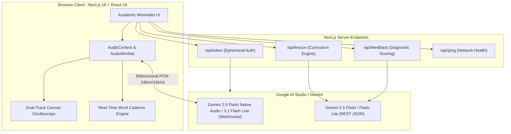
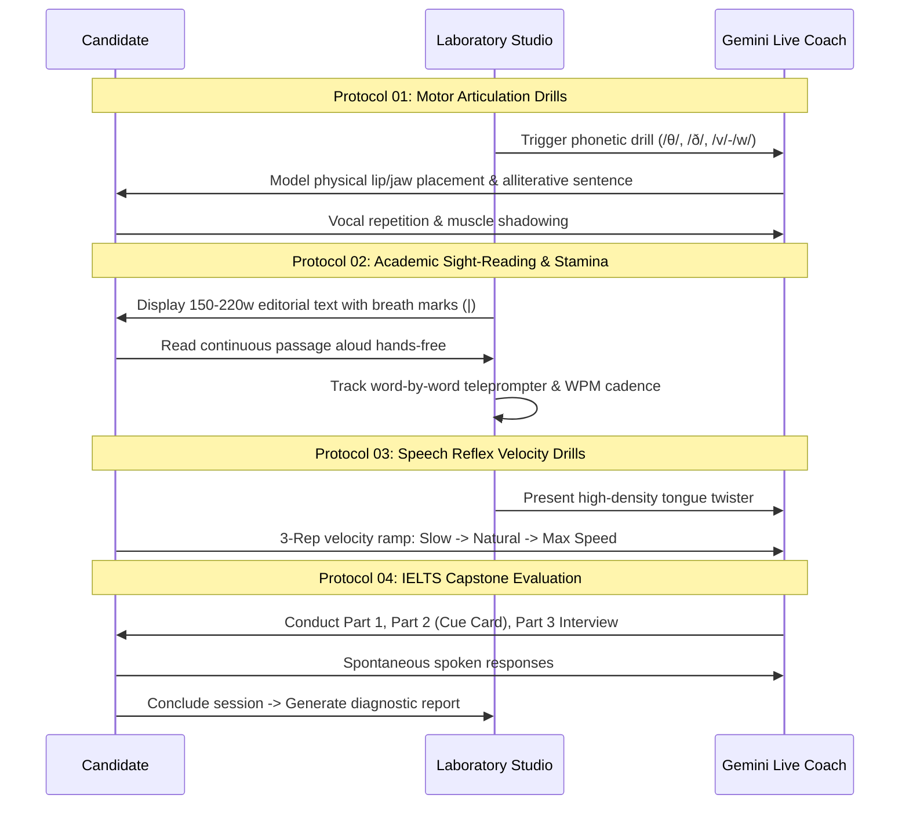

# English Phonetics & Vocal Laboratory (IELTS Vocal Gym)
### Comprehensive Architectural Overview & Technical Specification

---

## 1. Executive Summary & Vision

The **English Phonetics & Vocal Laboratory** is a real-time, hands-free conversational speaking gym designed to help learners, professionals, and IELTS candidates conquer speech hesitation, vocal freezing, and articulatory inaccuracies.

Instead of traditional passive language learning (quizzes, static audio recordings, or text-heavy chatbots), this project provides a **live, voice-driven physical workout studio**. It couples real-time bidirectional AI audio with continuous teleprompter tracking, live WPM cadence telemetry, and clinical vocal diagnostics.

```
┌────────────────────────────────────────────────────────────────────────┐
│                        CORE PHILOSOPHY & INSPIRATION                   │
│                                                                        │
│   Inspired by Tarteel AI: Hands-Free Voice Tracking & Live Correction  │
│                                      │                                 │
│                                      ▼                                 │
│           Powered by Google Gemini Live Multimodal Audio Engine         │
│                                      │                                 │
│                                      ▼                                 │
│     Minimalist Academic Studio: Oscilloscope Telemetry & Lora Serif    │
└────────────────────────────────────────────────────────────────────────┘
```

---

## 2. The Core Inspiration: The Tarteel Paradigm

The architectural concept was sparked by **Tarteel**, an AI-powered Quran companion known for its hands-free acoustic voice tracking:
- **Zero-Touch Interaction:** The speaker recites freely; the system listens continuously without requiring "Record" or "Submit" taps.
- **Real-Time Text Following:** The display advances dynamically, tracking word-by-word progress as words are pronounced.
- **Instant Error Detection:** Deviations, omissions, or mispronunciations are flagged in the moment.

### Translating to English Fluency & IELTS Prep:
Most English learners suffer from **articulatory fatigue, jaw tension, and mental latency** rather than a lack of vocabulary. This application brings Tarteel's hands-free, real-time voice-following paradigm to English phonetics:
1. Candidate reads sight-reading passages hands-free.
2. Teleprompter highlights words in sync with vocal cadence.
3. Live AI examiner listens and responds instantly with human-speed audio feedback.

---

## 3. System Architecture & Tech Stack



### Technology Matrix

| Layer | Technologies | Rationale |
| :--- | :--- | :--- |
| **Framework** | Next.js 16 (Turbopack, App Router), React 19, TypeScript | High-performance server rendering with instant client streaming. |
| **Styling** | Tailwind CSS v4, Lucide Icons | Ultra-fast styling engine, zero runtime CSS footprint. |
| **Typography** | `Lora` (Serif) + `Geist Mono` (Monospace) | Editorial publication reading desk paired with research-grade telemetry. |
| **Live Audio AI** | Gemini 2.5 Flash Native Audio & Gemini 3.1 Flash Live | Sub-second bidirectional voice interaction over WebSocket. |
| **Curriculum & Grading** | Gemini 2.5 Flash & 3.5 Flash-Lite | Structured JSON curriculum generation and IELTS band evaluation. |
| **Client Audio Pipeline** | Web Audio API (`AudioContext`, `AudioWorkletNode`, `AnalyserNode`) | Low-latency 16-bit PCM streaming, DSP time-domain waveform analysis. |
| **Fallback Speech Engine** | Web Speech API (`SpeechRecognition`, `SpeechSynthesis`) | Self-healing watchdog mechanism for offline / secondary speech operations. |

---

## 4. The 4-Stage Laboratory Workout Protocol

The curriculum structured by the `/api/lesson` generator follows an academic phonetics progression designed to warm up speech muscles before tackling complex discourse:



### Stage Details

1. **Section I: Motor Articulation Drills (`motor_warmup`)**
   - Targets difficult English phonemes: dental fricatives (`/θ/`, `/ð/`), labiodental vs. bilabial (`/v/` vs. `/w/`), liquids (`/r/` vs. `/l/`), and terminal consonant clusters (`-sts`, `-dth`, `-lved`).
   - Accompanied by biomechanical jaw, lip, and tongue placement cues.

2. **Section II: Academic Sight-Reading & WPM Cadence (`long_reading`)**
   - Continuous 150–220 word editorial sight-reading passage on curated academic themes (e.g., *Deep Ocean Bathymetry*, *Cosmology & Dark Matter*, *Acoustic Resonance*).
   - Real-time word-by-word teleprompter tracking with live Words-Per-Minute (WPM) cadence calculation.
   - Natural breath unit breakdown (`thoughtChunks`) showing rhythmic breathing marks (`|`).
   - High-density vocabulary cards with International Phonetic Alphabet (IPA) transcriptions.

3. **Section III: Speech Reflex Velocity Drills (`speed_drill`)**
   - Ramped tongue twisters to break muscular stiffness and stutter.
   - Structured 3-repetition methodology:
     - **Rep 01:** Slow & exaggerated physical shapes.
     - **Rep 02:** Natural conversational rhythm.
     - **Rep 03:** Maximum velocity without hesitation.

4. **Section IV: IELTS Speaking Exam Capstone (`ielts_test`)**
   - Realistic exam simulation spanning Part 1 (Introduction/Interview), Part 2 (Cue Card with 1-min prep and 2-min speaking timers), and Part 3 (Two-way abstract discussion).

---

## 5. User Interface Innovation: Minimalist Academic Studio

To eliminate generic AI tropes (blinding purple gradients, cartoonish icons, pulsing orbs), the UI was redesigned as a **clean, monochromatic scientific workstation**:

```
┌────────────────────────────────────────────────────────────────────────────────────────┐
│ PHONETICS LAB [ IELTS-ACADEMIC ]   [01. WARMUP] [02. SIGHT-READING] ...   [RTT: 42ms]  │
├──────────────────────────────────────────┬─────────────────────────────────────────────┤
│ ACOUSTIC OSCILLOSCOPE MONITOR            │ SECTION II: ACADEMIC SIGHT-READING          │
│ ┌──────────────────────────────────────┐ │ ┌─────────────────────────────────────────┐ │
│ │ CH1 RMS: -18.4 dBFS [OSCILLOSCOPE]   │ │ │ Editorial passage in academic Lora      │ │
│ │ CH2 EXAMINER: STANDBY                │ │ │ serif font with real-time teleprompter  │ │
│ └──────────────────────────────────────┘ │ │ underline & WPM cadence meter           │ │
│ [ MIC: CONTINUOUS ]  [ BARGE-IN ]        │ └─────────────────────────────────────────┘ │
│ [ ADVANCE TO PROTOCOL 02 → ]             │ [ LABORATORY MATERIAL ]  [ TRANSCRIPT LOG ] │
└──────────────────────────────────────────┴─────────────────────────────────────────────┘
```

### Distinctive Design Decisions:
- **Acoustic Dual-Trace Oscilloscope (`VoiceOrb.tsx`):** Renders a real-time oscilloscope waveform of candidate microphone input on Channel 1 (calculating RMS dBFS levels) and a 32-band spectral formant bar array on Channel 2 for examiner vocal playback.
- **Academic Editorial Desk (`LessonCard.tsx`):** Uses the `Lora` serif font family for high legibility during prolonged reading, formatted like a linguistic journal.
- **Transcription Journal (`TranscriptFeed.tsx`):** Clean laboratory entry feed with turn-by-turn timestamps, word counts, and single-click phonetic replay.
- **Diagnostic Telemetry HUD (`LatencyHUD.tsx`):** Live monitoring of round-trip time (RTT), model time-to-first-byte (TTFB), audio buffer underruns, and packet loss.

---

## 6. Key Engineering Innovations & Reliability Fixes

During the system review and testing cycles, several deep technical enhancements were implemented:

### 1. Robust Fault-Tolerant JSON Parser (`safeParseJson` in `src/lib/gemini.ts`)
LLMs occasionally return markdown fences (` ```json `), trailing commas before braces, or preamble commentary that breaks standard `JSON.parse()`.
- Strips markdown formatting and isolates the outermost `{ ... }` or `[ ... ]`.
- Cleans trailing commas and invalid control characters.
- Provides typed fallback structures to prevent client-side runtime crashes.

### 2. Self-Healing Speech Recognition Watchdog (`src/lib/speech-engine.ts`)
Browser-native `webkitSpeechRecognition` frequently drops connections or silently freezes in Chromium:
- Added a debounced reconnection routine on `rec.onend` (150ms backoff).
- Embedded a 5-second active watchdog interval to revive stalled recognizers.
- Integrated `speechSynthesis.resume()` before speaking to prevent Chromium synthesizer lockups.

### 3. Leak-Free AudioTeardown Routine (`src/lib/live-session.ts`)
Frequent session restarts can leave microphone hardware tracks and Web Audio contexts active in background tabs:
- Built an idempotent `teardownAudio()` method that explicitly stops all `MediaStreamTrack` hardware channels, disconnects `AudioWorkletNode` ports, closes active `AudioContext` instances, and terminates open WebSockets.
- Invoked both on session restart and tab closure (`beforeunload` lifecycle listener).

### 4. Teleprompter Word Count Accumulation (`src/app/page.tsx`)
Previously, fragmented transcript deltas caused running word counters to stall:
- Linked `currentStageRef` to avoid stale React closures during multi-stage workouts.
- Implemented cumulative word summation across all candidate entries in the active stage, enabling smooth 150–220 word teleprompter highlighting.

---

## 7. Directory Structure & Key Files

```
ielts-coach/
├── public/
│   └── worklets/
│       └── pcm-processor.js        # AudioWorklet for low-latency PCM conversion
├── src/
│   ├── app/
│   │   ├── api/
│   │   │   ├── feedback/route.ts   # Diagnostic band scoring & biomechanics analysis
│   │   │   ├── lesson/route.ts     # Dynamic 4-stage vocal workout generator
│   │   │   ├── ping/route.ts       # Network RTT & edge latency health check
│   │   │   └── token/route.ts      # Ephemeral token provisioner for Gemini Live
│   │   ├── globals.css             # Tailwind v4 configuration & theme tokens
│   │   ├── layout.tsx              # Root HTML layout with Lora & Geist font loading
│   │   └── page.tsx                # Main stateful dual-console cockpit
│   ├── components/
│   │   ├── FeedbackReport.tsx      # Academic evaluation report with 9.0 band criteria
│   │   ├── LatencyHUD.tsx          # Real-time network latency, TTFB, and dropout HUD
│   │   ├── LessonCard.tsx          # Sight-reading desk, breath marks & drill controls
│   │   ├── SetupCard.tsx           # Laboratory routine & target band configuration
│   │   ├── TranscriptFeed.tsx      # Phonetic journal log with audio replay
│   │   └── VoiceOrb.tsx            # Dual-trace acoustic oscilloscope & FFT visualizer
│   └── lib/
│       ├── gemini.ts               # Resilient LLM client with safeParseJson utility
│       ├── live-session.ts         # WebSocket Gemini Live client & AudioGraph lifecycle
│       ├── models.ts               # Central model definitions & voice persona configs
│       ├── prompts.ts              # System instructions & stage-specific cues
│       ├── speech-engine.ts        # Self-healing Web Speech STT/TTS auxiliary engine
│       └── types.ts                # TypeScript domain models, stages & telemetry types
├── package.json
└── tsconfig.json
```

---

## 8. Summary of Achievements

1. **Hands-free voice UX inspired by Tarteel**, eliminating the barrier of lonely speaking practice.
2. **Sub-second bidirectional audio streaming** using Google Gemini Live APIs.
3. **Research-grade aesthetic** featuring a dual-trace oscilloscope visualizer and publication typography.
4. **Resilient audio infrastructure** with zero memory leaks and self-healing speech recognition.
5. **Completely functional on free-tier developer resources**, proving that cutting-edge AI speech tools are accessible to any builder.
