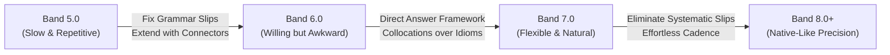

# The Definitive IELTS Speaking Mastery Guide
### Empirical Research, Examiner Methodology & Step-by-Step Band Acceleration Blueprint

> **Synthesized From:** Cambridge Official Examiner Criteria, Pauline Cullen (*The Key to IELTS Speaking*), Keith O'Hare (*Keith Speaking Academy*), and Chris Pell (*IELTS Advantage*).

---

## 1. The Real Examination Mechanics: The 4 Criteria

Every IELTS speaking test is judged across four equally weighted criteria (25% each). Understanding how examiners actually score them is the first step to unlocking higher bands:

```
┌───────────────────────────┬───────────────────────────┐
│ FLUENCY & COHERENCE (25%) │  LEXICAL RESOURCE (25%)   │
│ • Speech rate & rhythm    │ • Range of vocabulary     │
│ • Hesitation types        │ • Collocation accuracy    │
│ • Cohesion & sequencing   │ • Natural paraphrasing    │
├───────────────────────────┼───────────────────────────┤
│ GRAMMAR RANGE & ACC (25%) │    PRONUNCIATION (25%)    │
│ • Complex sentence ratio  │ • Intonation & stress     │
│ • Error-free density      │ • Connected speech        │
│ • Tense & clause agility  │ • Phonemic clarity        │
└───────────────────────────┴───────────────────────────┘
```

---

## 2. Step-by-Step Progression: Band 5.0 to 9.0

Examiners do not look for "perfection"; they identify **threshold patterns**. Here is the exact diagnostic roadmap to move from each band to the next:



### Stage 1: Climbing from Band 5.0 to 6.0 (From "Broken" to "Coping")
* **The Band 5 State:** Short, fragmented answers (*"I like my job. It is good."*); frequent pauses while translating words in head; repetitive basic connectors (*"and then... so... because"*); systematic grammar errors with plurals, past tense `-ed`, and subject-verb agreement.
* **The Breakthrough Strategy:**
  1. **Kill the One-Sentence Answer:** Force yourself to say **at least 2 to 3 sentences** for every question.
  2. **Audit Core Grammar Errors:** 90% of Band 5 students lose marks on simple past tense (*"Yesterday I go..."*) and third-person `s` (*"He work..."*). Fix these first.
  3. **Use Simple, Dependable Connectors:** Upgrade from endless *"and"* to *"as well as that"*, *"in addition"*, and *"on top of that"*.

---

### Stage 2: Breaking the Band 6.5 Plateau to Band 7.0 (The Critical Barrier)
* **The Band 6.0/6.5 State:** Can speak at length, but falls into the **"Shotgun Trap"** (rambling, unfocused shopping lists of ideas) or forces memorized, inappropriate idioms (*"It is raining cats and dogs"*, *"Every coin has two sides"*), which examiners instantly penalize.
* **The Breakthrough Strategy:**
  1. **Adopt Chris Pell's Direct Answer Framework:** 
     - **Sentence 1 (Anchor):** Answer the question directly within the first 3 seconds.
     - **Sentence 2 (Reason):** State the immediate cause or context.
     - **Sentence 3 (Example/Detail):** Provide one specific personal illustration.
  2. **Stop Memorizing Isolated "Fancy" Words:** Examiners do not reward obscure words; they reward **Collocations** (words that naturally belong together).
  3. **Master Thought-Chunk Intonation:** Stop speaking in a flat, robotic monotone. Raise pitch slightly on key content words and drop pitch at sentence closures.

---

### Stage 3: Ascending from Band 7.0 to 8.0+ (Near-Native Mastery)
* **The Band 7.0 State:** Fluent, flexible, comfortable, but makes occasional minor word choice slips or hesitates when searching for complex vocabulary.
* **The Breakthrough Strategy:**
  1. **Zero-Hesitation on Content:** Hesitations must be *topic-related* (*"Let me think about that for a second..."*), never *language-related* (*"Ummm... how do you say..."*).
  2. **Effortless Structural Paraphrasing:** Demonstrating structural flexibility (switching between active, passive, participle clauses, and cleft sentences like *"What fascinates me most is..."*).
  3. **Nuanced Register:** Knowing when to be colloquial in Part 1 (*"I've kind of gone off that lately"*) and when to be academically analytical in Part 3 (*"That trend is largely attributable to socioeconomic factors"*).

---

## 3. Sentence Structure Mastery: 5 High-Yield Architectural Templates

At Band 6, candidates string together basic sentences using *"and", "but", "so"*.  
At Band 7 and 8, speech is characterized by **syntactic variety** without sounding forced or rehearsed.

```
┌────────────────────────────────────────────────────────────────────────┐
│                   THE 5 HIGH-YIELD SENTENCE TEMPLATES                  │
├────────────────────────────────────────────────────────────────────────┤
│ 1. Cleft Sentences (Focus & Emphasis)                                  │
│ 2. Concessive Contrast Clauses (Balancing Nuance)                      │
│ 3. Relative Clauses (Embedded Context)                                 │
│ 4. Participle Phrases (Concise Narrative Flow)                         │
│ 5. Second & Third Conditionals (Hypothetical & Speculative)            │
└────────────────────────────────────────────────────────────────────────┘
```

### Template 1: Cleft Sentences (for Instant Emphasis & Natural Cadence)
Instead of starting with flat pronouns (*"I like..."*), use a cleft sentence to put the spotlight on what matters most:
- **Basic (Band 6):** *"I really like the peaceful mornings in my city."*
- **Cleft Upgrade (Band 7.5+):**  
  👉 **"What I find most appealing about my neighborhood is** *the tranquil atmosphere early in the morning."*  
  👉 **"It was actually my father who** *first encouraged me to get into coding."*

### Template 2: Concessive Clauses (Showing Maturity & Multi-Sided Thinking)
Examiners love answers that acknowledge two sides of an issue without rambling:
- **Basic (Band 6):** *"Remote work is lonely but I like it because it saves time."*
- **Concessive Upgrade (Band 7.5+):**  
  👉 **"While it can occasionally feel a bit isolating,** *working remotely offers unparalleled autonomy over my schedule."*  
  👉 **"Even though public transit is notoriously crowded during rush hour,** *it remains by far the most economical way to commute."*

### Template 3: Embedded Relative Clauses (Context Density)
Avoid splitting simple thoughts into two childish sentences:
- **Basic (Band 6):** *"I live in Chittagong. It is a coastal port city."*
- **Embedded Upgrade (Band 7.5+):**  
  👉 *"I'm based in Chittagong, **which is widely known as the commercial maritime hub of the country**."*

### Template 4: Participle Phrases (Smooth Narrative Transitions)
Connect past experiences to current perspectives cleanly:
- **Basic (Band 6):** *"I have lived here for 5 years. I know all the local spots."*
- **Participle Upgrade (Band 7.5+):**  
  👉 **"Having spent the better part of a decade in this neighborhood,** *I've developed a real fondness for the local community."*  
  👉 **"Looking back on my initial career choices,** *I wouldn't change a single step."*

### Template 5: Conditionals for Reflection & Speculation
A crucial discriminator between Band 6.5 and Band 8 in Grammatical Range:
- **Hypothetical Second Conditional:**  
  👉 *"If I were given the choice to live anywhere, **I'd almost certainly opt for a coastal retreat**."*
- **Third / Mixed Conditional for Life Reflections:**  
  👉 *"Had I not taken that internship during college, **I probably wouldn't be working in digital infrastructure today**."*

---

## 4. Grammar Precision Engine: Eliminating Band-Capping Slips

Examiners don't expect zero grammar errors, but they strictly differentiate between **systematic errors** (which trap you at Band 6.0) and **isolated slips** (which allow Band 8.0+).

| Grammar Domain | Band 6.0 Trap | Band 7.5+ Precision Upgrade |
| :--- | :--- | :--- |
| **Modal Stance** | Absolute black-or-white statements: *"People always want new phones."* | Nuanced hedging: *"People **tend to gravitate toward** newer models, though **one might argue** it's driven by marketing."* |
| **Tense Transitions** | Mixing up past and present: *"Yesterday I go there and I was happy."* | Clean tense shifting: Past Simple for specific events $\rightarrow$ Present Perfect for ongoing connection: *"I **first visited** back in 2021, and I'**ve been hooked** ever since."* |
| **Passive for Objectivity** | Overusing "They": *"They built many new highways."* | Natural passive voice in Part 3: *"**A substantial number of highways have been constructed** to ease traffic bottlenecks."* |
| **Gerund as Subject** | Awkward clunky nouns: *"The activity of running is good."* | Clean gerund phrasing: *"**Sticking to an early-morning workout routine** keeps my mental energy sharp all day."* |

---

## 5. Vocabulary Vault: Avoiding Word Overuse & The "Thesaurus" Trap

### The Cullen Golden Rule of Lexical Resource
> **Do not swap simple words for rare dictionary synonyms that you wouldn't naturally use.**  
> Examiners reward **Collocations** (words that naturally belong together) and **Phrasal Verbs**, not archaic words like *"plethora"* or *"tome"*.

### 1. High-Value Phrasal Verbs (The Secret to Band 8 Natural Fluency)
Native English speakers use phrasal verbs constantly in spoken speech. Using them appropriately proves natural fluency:

- **Instead of "relax / rest":**  
  👉 *"unwind"*, *"kick back"*, *"switch off from work"*  
  *Example:* *"After a relentless day of meetings, I usually need an hour to simply **switch off**."*
- **Instead of "choose / select":**  
  👉 *"opt for"*, *"gravitate towards"*  
  *Example:* *"Given the choice, I'll almost always **opt for** a quieter cafe."*
- **Instead of "encounter difficulties":**  
  👉 *"come up against hurdles"*, *"grapple with"*  
  *Example:* *"Whenever our dev team **comes up against a technical bottleneck**, we huddle together."*
- **Instead of "stop doing something":**  
  👉 *"go off something"*, *"phase it out"*  
  *Example:* *"I used to drink energy drinks, but I've completely **gone off them** recently."*

---

### 2. Collocation Triads: Upgrade Everyday Nouns & Adjectives

| Ordinary Word (Band 5/6) | Precision Collocation Sets (Band 7.5+) | Context Sentence |
| :--- | :--- | :--- |
| **"Good" (Place)** | *Vibrant, culturally rich, tranquil, hospitable* | *"It’s an incredibly **vibrant and hospitable community**."* |
| **"Good" (Job/Work)** | *Rewarding, intellectually stimulating, hands-on* | *"It provides **intellectually stimulating challenges** on a daily basis."* |
| **"Bad" (Situation)** | *Far from ideal, a bit of a nuisance, a steep climb* | *"The public transit schedule is **far from ideal** during late hours."* |
| **"Important"** | *Pivotal, the cornerstone, carries significant weight* | *"Physical exercise is the **cornerstone of my morning routine**."* |
| **"Busy"** | *Hectic, bustling, wall-to-wall, relentless* | *"It's a **bustling commercial district** with wall-to-wall activity."* |
| **"Change"** | *Undergo a transformation, shift the paradigm, evolve* | *"The city has **undergone a dramatic transformation** in recent years."* |

---

### 3. Structural Paraphrasing: How to Stop Parroting the Examiner

When the examiner asks a question, **never repeat their exact words**. Use **Structural Paraphrasing**:

```
┌────────────────────────────────────────────────────────────────────────┐
│                   STRUCTURAL PARAPHRASING BLUEPRINTS                   │
├────────────────────────────────────────────────────────────────────────┤
│ 1. Active to Passive Shift:                                            │
│    Examiner: "Why do governments spend money on parks?"                │
│    Candidate: "Well, significant public capital is allocated toward..." │
│                                                                        │
│ 2. Adjective to Nominalization Shift:                                  │
│    Examiner: "Is living in the city expensive?"                        │
│    Candidate: "Without a doubt, the sheer cost of living in urban..."  │
│                                                                        │
│ 3. Question Clause Shift:                                              │
│    Examiner: "What is your favorite hobby?"                            │
│    Candidate: "What I genuinely look forward to during weekends is..." │
└────────────────────────────────────────────────────────────────────────┘
```

---

## 6. The 5 Universal Core Starter Topics with Master AER Responses

### Domain 1: Work, Study & Career
- **Question:** *"Do you work or are you a student?"*
- **AER Formula Answer:**  
  `[Direct Anchor]` *"At the moment, I'm working as a software developer for a digital agency based in the city center.*  
  `[Reason/Context]` *I've been in this role for about two years now, primarily architecting web infrastructure and collaborating with cross-functional teams.*  
  `[Personal Detail]` *What I appreciate most about it is the creative autonomy—no two working days look identical."*

### Domain 2: Hometown & Roots
- **Question:** *"Tell me about the town where you grew up."*
- **AER Formula Answer:**  
  `[Direct Anchor]` *"I was born and raised in Chittagong, which is a major coastal port city in the southeastern part of the country.*  
  `[Reason/Context]` *It's known for its rolling green hills and maritime trade, though over the last decade, it’s become noticeably more congested.*  
  `[Personal Detail]` *Whenever I head back to visit family, my go-to spot is the coastline—it’s the one place where you can escape the urban hustle."*

### Domain 3: Home & Living Space
- **Question:** *"Do you live in a house or an apartment?"*
- **AER Formula Answer:**  
  `[Direct Anchor]` *"Currently, I reside in a seventh-floor rented apartment with a small balcony facing a residential street.*  
  `[Reason/Context]` *It’s relatively compact, but the open-plan layout lets in a tremendous amount of natural sunlight.*  
  `[Personal Detail]` *My favorite corner is definitely my study nook by the window, where I set up my dual monitors and espresso maker."*

### Domain 4: Daily Routine & Morning Habits
- **Question:** *"What is your typical morning routine?"*
- **AER Formula Answer:**  
  `[Direct Anchor]` *"I tend to be an early riser, so my alarm usually goes off around six.*  
  `[Reason/Context]` *I make a conscious point not to check my phone for the first hour; instead, I brew some fresh filter coffee and do 45 minutes of strength training.*  
  `[Personal Detail]` *That physical momentum sets the tone for my whole workday and keeps brain fog at bay."*

### Domain 5: Leisure, Unwinding & Passions
- **Question:** *"What do you like to do to relax after a hectic week?"*
- **AER Formula Answer:**  
  `[Direct Anchor]` *"Whenever I get some breathing room on the weekends, I usually gravitate toward cooking from scratch.*  
  `[Reason/Context]` *There's something deeply therapeutic about working with fresh produce and experimenting with aromatic spices after staring at screens all week.*  
  `[Personal Detail]` *Occasionally, I'll host a couple of close friends over for dinner, which is my favorite way to recharge."*

---

## 7. Daily Deliberate Practice Regimen (The 20-Minute Muscle Protocol)

```
┌────────────────────────────────────────────────────────────────────────┐
│                   THE 20-MINUTE DAILY VOCAL ROUTINE                    │
├─────────┬──────────────────────┬───────────────────────────────────────┤
│ MINUTES │ ACTIVITY             │ EXECUTABLE INSTRUCTION                │
├─────────┼──────────────────────┼───────────────────────────────────────┤
│ 00 - 05 │ Chunks & Opener Drills│ Read 5 conversational linking chunks   │
│         │                      │ aloud 10x each to warm speech muscles.│
├─────────┼──────────────────────┼───────────────────────────────────────┤
│ 05 - 12 │ Exemplar Shadowing   │ Read a model answer synchronously     │
│         │ (Teleprompter)       │ with breath marks (|) at 130 WPM.     │
├─────────┼──────────────────────┼───────────────────────────────────────┤
│ 12 - 16 │ 1.5s Reflex Sprint   │ Answer 3 random starter prompts with  │
│         │                      │ zero hesitation using AER formula.    │
├─────────┼──────────────────────┼───────────────────────────────────────┤
│ 16 - 20 │ Self-Audit & Replace │ Transcribe 1 answer, highlight any    │
│         │                      │ repeated words, replace with chunks.  │
└─────────┴──────────────────────┴───────────────────────────────────────┘
```
