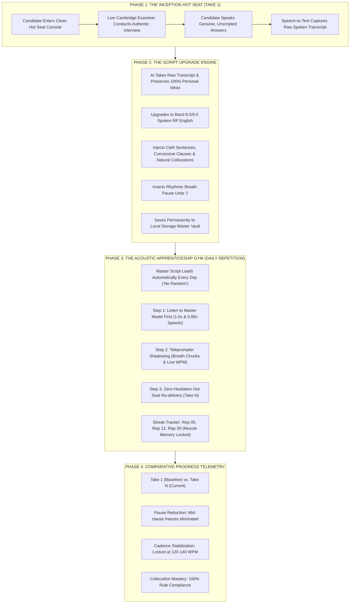
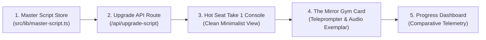

# The Master Script Vault & Acoustic Apprenticeship Blueprint
## High-Repetition Vocal Muscle Memory, Authentic Hot-Seat Capture & Native Exemplar Mirroring

> *"My mother taught me how to write alphabets, and my handwriting looks close to her writing. Finding someone truly good at something and learning directly from them sets a beautiful, unconscious pattern into our habits and muscle memory."*

---

## 1. Executive Philosophy: The Acoustic Apprenticeship

### 1.1 The Handwriting Axiom (Mirror Neurons in Phonetics)
Human beings do not master motor skills through abstract rulebooks or grammatical theorems. We master motor skills through **direct imitation of a master model**. Just as a child's fingers unconsciously absorb the rhythm, slant, and curvature of a parent's handwriting, our vocal tract (vocal cords, tongue blade, soft palate, and jaw) naturally mirrors the pitch contour, breath phrasing, and resonance of voices we listen to repeatedly.

When a non-native speaker tries to "think in grammar rules" during an exam, their prefrontal cortex experiences severe cognitive overload, resulting in **mid-sentence freezes**, throat tension, and monotone delivery. Conversely, when a candidate listens to an articulate Received Pronunciation (RP) British exemplar speak **their own personal ideas**, the brain's mirror neurons establish the melody, stress-timing, and breath pacing long before the candidate speaks.

### 1.2 The "No-Random Repetition" Rule
In real exams (IELTS, PTE, professional interviews), examiners do not test unpredictable science trivia. They probe the **same core anchors of human existence**:
- Who you are, your technical career specialization, and professional responsibilities
- Your hometown roots, architecture, and living space ergonomics
- Your daily energy rhythms, morning routines, and evening unwinding habits
- How you recount a memorable past challenge, describe an influential person, and analyze societal trends

**Fluency is not built by answering 100 random questions once. Fluency is forged by taking your genuine life answers, polishing them into Band 8.5/9.0 spoken English, and repeating that exact same Master Script 20, 30, or 50 times until jaw articulation and breath control become an unconscious reflex.**

---

## 2. System Architecture: The 3-Phase Journey



---

## 3. Data Schema: The Master Script Vault

The candidate's master script is stored permanently in browser `localStorage` under `vocal_lab_master_script_v2` and managed through `useSyncExternalStore` for zero-render hydration safety.

```typescript
export interface ScriptItem {
  id: string; // e.g. "canonical-work-01", "canonical-hometown-02"
  part: "part1" | "part2" | "part3";
  question: string; // The canonical examiner question
  originalRawSpoken: string; // What the candidate actually said in Take 1
  upgradedScript: string; // Band 8.5+ native spoken rewrite of THEIR thoughts
  thoughtChunks: string[]; // Rhythmic breath units ending with '|'
  targetCollocations: {
    phrase: string;
    meaning: string;
    phoneticTip: string;
  }[];
  masterCadenceWpm: number; // e.g. 130 WPM
  personalNotes?: string;
}

export interface MasterScriptRepository {
  id: string;
  candidateName: string;
  preferredName: string;
  targetBand: "5.5" | "6.5" | "7.5" | "8.5";
  createdAt: number;
  lastPracticedAt: number;
  totalPracticeCount: number; // Increments with each repetition session
  streakDays: number;
  items: ScriptItem[];
}
```

---

## 4. The Acoustic Apprenticeship Mechanics (The Mirror Engine)

### 4.1 "Listen to the Master Model First"
Before candidates are ever asked to speak an answer in the daily gym, the app presents the **Golden Exemplar**:
- **RP British Acoustic Model**: Synthesized in warm, crisp Received Pronunciation (using Gemini Live audio or high-fidelity neural speech).
- **Pitch Melody Modeling**: The coach's voice demonstrates:
  - *Rising inflection* at introductory subordinate clauses (`"Given the demands of cloud engineering ↗️,"`)
  - *Sustained plateau* during thought formulation (`"what I find particularly compelling ➡️"`)
  - *Falling tone of authority* at period closures (`"is resolving distributed bottlenecks ↘️."`)
- **Two Speed Switches**:
  - `[ MODEL 1.0X ]`: Natural conversational cadence (130 WPM).
  - `[ ARTICULATION 0.85X ]`: Slowed tempo revealing tongue tip placement, vowel length, and consonant releases.

### 4.2 Visual Rhythm & Stress Notation (Seeing the Music)
The teleprompter does not display a wall of flat text. It displays the **musical score of the sentence**:

```text
[Chunk 1]: At the moment, | 
[Chunk 2]: I'm PRIMARILY responsible for | 
[Chunk 3]: building distributed cloud infrastructure. | 
[Chunk 4]: Much as the workload can be DEMANDING, | 
[Chunk 5]: WHAT I find most rewarding | 
[Chunk 6]: is resolving complex system bottlenecks. |
```

- **Capitalized/Bold words** indicate tonic stress (where the voice punches the beat).
- **Pipe markers (`|`)** indicate mandatory diaphragmatic inhalations.
- **Underlines** indicate connected speech liaisons (e.g., *primarily_responsible_for* glides as one muscular impulse).

### 4.3 The 3-Repetition Daily Workout Cycle
For each canonical question in the vault:

| Repetition Round | Focus | Interaction |
| :--- | :--- | :--- |
| **Rep 01: Absorb** | **Ear & Brain** | Eyes closed. Listen to the British Master Model twice (1.0x and 0.85x). Absorb the melody and breath pauses. |
| **Rep 02: Shadow** | **Vocal Cords & Tongue** | Read along with the teleprompter out loud *simultaneously* with the coach audio. Words highlight as you speak; match the 120–140 WPM gauge. |
| **Rep 03: Deliver** | **Muscle Automaticity** | The coach asks the question. The script dims. You speak the upgraded answer from pure vocal muscle memory within 1.5s with zero hesitation words. |

---

## 5. The AI Script Upgrade Engine

When Take 1 is completed, the backend calls `/api/upgrade-script`. The LLM evaluator transforms the candidate's raw answers under strict pedagogical rules:

### 5.1 The 4 Upgrade Rules
1. **Preserve 100% of the Candidate's Truth**: NEVER substitute the candidate's career, city, or personal thoughts with fictional trivia. If the candidate said they like cooking pasta, the Band 8.5 upgrade is about cooking pasta from fresh ingredients.
2. **Inject Cambridge Band 8+ Syntactic Architecture**:
   - Transform flat simple sentences into **Cleft Sentences** (*"What strikes me most is..."*)
   - Add **Fronted Adverbial Participle Clauses** (*"Having worked in tech for four years, ..."*)
   - Add **Concessive Clauses** (*"Much as the city can be hectic, it affords unmatched career opportunities."*)
3. **Enforce the "100% Rule" (No Forced Idioms)**:
   - Eliminate clichés like *"raining cats and dogs"*, *"every coin has two sides"*, or *"at the drop of a hat"*.
   - Replace them with **high-frequency native collocations** (e.g., *"steep learning curve"*, *"distributed architecture"*, *"maritime heritage"*, *"sensory restoration"*).
4. **Format into Rhythmic Thought Units**:
   - Divide the entire upgrade into 4–6 breath units marked by `|`.

---

## 6. Implementation Roadmap



### Detailed Execution Steps

- [ ] **Step 1: Implement `src/lib/master-script.ts`**
  - Define `ScriptItem`, `MasterScriptRepository`, and repetition logging.
  - SSR-safe `localStorage` helper with `useSyncExternalStore` subscription.
  - Seed default canonical questions (Career, Hometown, Living Space, Daily Habit, Cue Card).

- [ ] **Step 2: Implement `src/app/api/upgrade-script/route.ts`**
  - Endpoint receiving the Take 1 transcript array.
  - Gemini prompt transforming candidate turns into Band 8.5 Master Scripts with cleft structures and `|` thought chunks.

- [ ] **Step 3: Update `SetupCard.tsx` with Master Vault Status**
  - If Master Script exists: displays `[ MASTER SCRIPT LOADED: 5 Canonical Answers • Practiced 8 Times ]`.
  - Action buttons: `[ ENTER DAILY MIRROR GYM ]` or `[ RETAKE AUTHENTIC HOT SEAT ]`.

- [ ] **Step 4: Build `src/components/MasterMirrorGym.tsx`**
  - Unified desk replacing the fragmented 4-stage UI.
  - Features:
    - Master Model Audio player (1.0x & 0.85x)
    - Visual rhythm teleprompter with bold stress and `|` breath pauses
    - Live WPM cadence speedometer
    - Repetition counter button (`[ LOG REP 09 COMPLETE ✅ ]`)

- [ ] **Step 5: Build `src/components/ComparativeReport.tsx`**
  - Shows original Take 1 transcript vs. Current Upgraded Take side-by-side.
  - Visualizes pause reduction, cadence stability, and lexical improvements.
